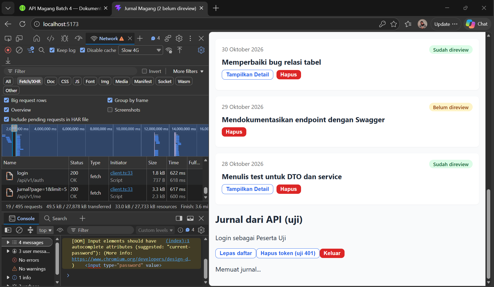
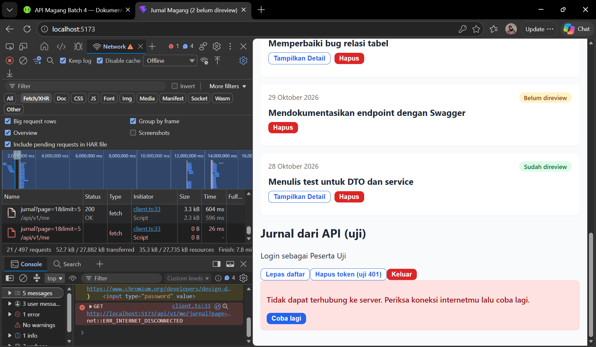
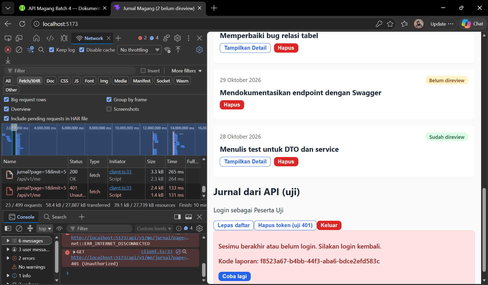
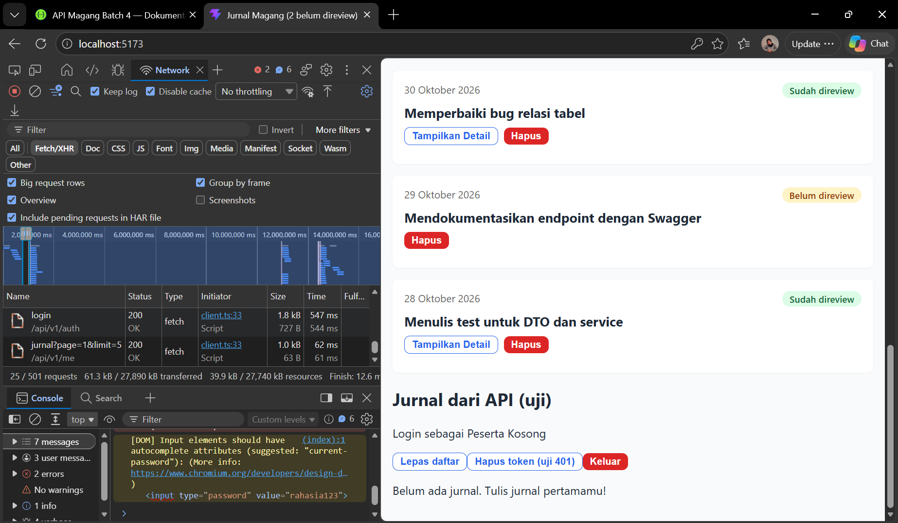
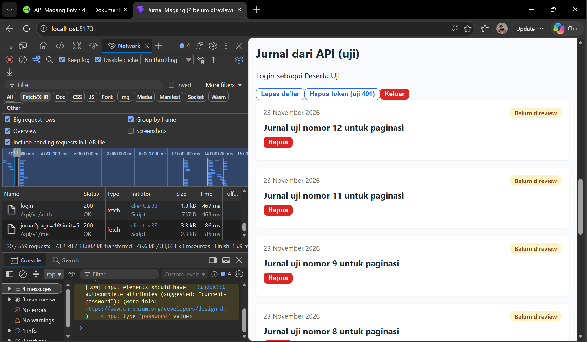

# Magang Web 
Aplikasi jurnal magang interaktif tanpa API. Peserta menulis jurnal harian, mentor mereview
dengan catatan, dan semua data tetap ada setelah halaman dimuat ulang.
Dibuat dengan React, TypeScript (strict), Vite, dan CSS Modules.

## Jawaban Soal 8 (Minggu 17 - Senin)

**1. Apa bedanya pendekatan imperatif dan deklaratif?**
Pendekatan imperatif (seperti JavaScript DOM biasa) berfokus pada *bagaimana* cara mencapai suatu hasil, di mana kita harus memerintahkan browser langkah demi langkah (misal: buat elemen, ubah teks, lalu masukkan ke halaman). Sedangkan pendekatan deklaratif (seperti React) berfokus pada *apa* hasil akhir yang diinginkan; kita cukup mendeskripsikan tampilan berdasarkan data, dan React yang akan mengurus langkah-langkah pembaruan DOM secara efisien di balik layar.

**2. Kenapa frontend dan backend dibuat sebagai dua aplikasi terpisah?**
Memisahkan frontend dan backend membuat sistem lebih modular dan fleksibel. Backend (API) bisa digunakan oleh berbagai platform sekaligus (web, mobile, atau aplikasi pihak ketiga) tanpa harus mengubah kodenya. Selain itu, tim pengembang bisa bekerja secara paralel (tim frontend fokus pada UI/UX di browser, tim backend fokus pada database dan logika bisnis di server), serta memudahkan proses *deployment* dan *scaling* di masa depan.

## Jawaban Soal 2 (Minggu 17 - Selasa)

### Kasus A — properti `fase` bertipe string

Kode yang diuji:
```tsx
const salah: Peserta = { id: 1, nama: "X", sekolah: "Y", email: "z@mail.com",
                          fase: "satu", status: "aktif", role: "peserta" };
```

Hasil:
- VS Code: garis merah di `"satu"`, tooltip `Type 'string' is not assignable to type 'number'. ts(2322)`
- Terminal (`npm run build`):
  ```
  src/App.tsx:18:5 - error TS2322: Type 'string' is not assignable to type 'number'.
  18     fase: "satu",
         ~~~~
    src/types/peserta.ts:6:3 - The expected type comes from property 'fase'
    which is declared here on type 'Peserta'
      6   fase: number;
  ```

Penyebab: `Peserta.fase` bertipe `number`, sedangkan `"satu"` bertipe `string`.
Perbaikan: ganti `"satu"` menjadi `1`.

Catatan penting:
- Saat `npm run dev`, error TIDAK muncul di browser (Vite tidak menjalankan tsc).
- Error tipe baru muncul di editor dan saat `npm run build` (tsc -b).
- `npm run build` = `tsc -b && vite build`. Kalau tsc gagal, vite build tidak jalan.

### Kasus B — prop yang tidak dikenal (`umur`)

Kode yang diuji:
```tsx
<PesertaCard peserta={daftarPeserta[0]} umur={20} />
```

Hasil:
- VS Code: garis merah di bawah `umur`, tooltip `Property 'umur' does not exist on type 'IntrinsicAttributes & PesertaCardProps'. ts(2322)`
- Terminal (`npm run build`):
  ```
  src/App.tsx:32:47 - error TS2322: Type '{ peserta: Peserta; umur: number; }'
  is not assignable to type 'IntrinsicAttributes & PesertaCardProps'.
    Property 'umur' does not exist on type 'IntrinsicAttributes & PesertaCardProps'.
  32       <PesertaCard peserta={daftarPeserta[0]} umur={20} />
                                                   ~~~~
  ```

Penyebab: `PesertaCardProps` hanya mendefinisikan `peserta` dan `tampilkanEmail?`, tidak ada properti `umur`.
Perbaikan: hapus prop `umur` (atau tambahkan `umur?: number` ke interface jika memang dibutuhkan).

### Kasus C — properti wajib (`nama`) hilang

Kode yang diuji:
```tsx
const salah: Peserta = { id: 2, sekolah: "Y", email: "z@mail.com",
                         fase: 1, status: "aktif", role: "peserta" };  // tanpa nama
```

Hasil:
- VS Code: garis merah di `salah`, tooltip `Property 'nama' is missing in type '{...}' but required in type 'Peserta'. ts(2741)`
- Terminal (`npm run build`):
  ```
  src/App.tsx:13:9 - error TS2741: Property 'nama' is missing in type
  '{ id: number; sekolah: string; email: string; fase: number; status: "aktif"; role: "peserta"; }'
  but required in type 'Peserta'.
    src/types/peserta.ts:3:3 - 'nama' is declared here.
      3   nama: string;
  ```

Penyebab: `nama` dideklarasikan wajib (tanpa `?`) di interface `Peserta`, sehingga objek bertipe `Peserta` wajib memilikinya.
Perbaikan: tambahkan `nama: "Nama Baru"` ke objek.

Catatan: kode `TS2741` (properti wajib hilang) berbeda dengan `TS2322` (tipe tidak cocok / properti tak dikenal).

## Pembuktian TypeScript Menolak Data Salah

| Kasus | Kesalahan | Kode Error | Pesan Inti |
|---|---|---|---|
| A | `fase: "satu"` (string, harus number) | TS2322 | `Type 'string' is not assignable to type 'number'` |
| B | `umur={20}` (prop tak dikenal) | TS2322 | `Property 'umur' does not exist on type '...PesertaCardProps'` |
| C | `nama` tidak ditulis (wajib hilang) | TS2741 | `Property 'nama' is missing ... but required in type 'Peserta'` |

Kesimpulan:
- Ketiga kesalahan tertangkap TypeScript **SEBELUM** kode dijalankan.
- Error muncul di editor dan saat `npm run build` (tsc -b), **BUKAN** di browser pengguna.
- Dev server (`npm run dev`) tidak menampilkan error tipe, karena Vite hanya mentranspile TS → JS tanpa type-check. Type-check hanya terjadi saat build.
- `TS2322` = tipe tidak cocok / properti tak dikenal.
- `TS2741` = properti wajib hilang.

## Jawaban Soal 3 — Kapan pakai `Pick` vs `Omit`?

**`Pick`** dipakai kalau kamu hanya butuh **sedikit** properti dari tipe besar.
Contoh: `PesertaRingkas` hanya perlu `nama`, `sekolah`, `fase` — tidak perlu `email`, `status`, `role`. Hasilnya tipe lebih kecil dan fokus, serta otomatis menolak properti lain.

**`Omit`** dipakai kalau kamu butuh **hampir semua** properti, tetapi ingin membuang satu atau dua yang tidak relevan.
Contoh: `PesertaTanpaEmail` butuh `id`, `nama`, `sekolah`, `fase`, `status`, `role` — hanya `email` yang dibuang (misal untuk daftar publik / privasi).

**Aturan praktis:**
- Kalau yang **DIPAKAI** lebih sedikit dari yang **DIBUANG** → pilih **`Pick`**.
- Kalau yang **DIBUANG** lebih sedikit dari yang **DIPAKAI** → pilih **`Omit`**.

## Jawaban Soal 6 — Kenapa nomor melompat?

**Versi tidak murni (sementara):**
```tsx
let urutan = 0;

function NomorUrut() {
  urutan = urutan + 1;
  return <p>Nomor {urutan}</p>;
}
```

Hasil di browser (dev, StrictMode aktif): nomor **melompat** — muncul **melompat (bukan 1, 2, 3)**.
Di Console (F12): `render NomorUrut` muncul **2× per komponen** → bukti StrictMode render 2×.

**Penyebab melompat:**
StrictMode sengaja merender komponen dua kali saat development untuk mendeteksi efek samping. Karena `NomorUrut` mengubah variabel luar setiap render, nilainya bertambah 2× per komponen. Ini **FITUR, bukan bug**.

Catatan: di build produksi nomornya akan 1, 2, 3 (StrictMode mati), tetapi komponennya **TETAP salah secara prinsip** — render tidak boleh mengubah apa pun di luar dirinya.

**Perbaikan (murni):**
```tsx
interface NomorUrutProps {
  nomor: number;
}

function NomorUrut({ nomor }: NomorUrutProps) {
  return <p>Nomor {nomor}</p>;
}
```

Pemakaian: `<NomorUrut nomor={1} />`, `<NomorUrut nomor={2} />`, `<NomorUrut nomor={3} />`
Hasil: nomor stabil 1, 2, 3. Props sama → tampilan sama.

## Jawaban Soal 8 (Rabu): Kenapa key sebaiknya ID dari database, bukan indeks array?

`key` adalah pengenal unik tiap item agar React bisa melacak item mana yang sama saat daftar berubah (ditambah, dihapus, atau diurutkan ulang). ID dari database bersifat **stabil** — nilainya tidak berubah antar render, sehingga React bisa memindahkan elemen dengan benar meskipun posisinya berubah. Sebaliknya, **indeks array berbahaya**: jika item pertama dihapus, item kedua akan "berpindah" ke indeks 0, dan React akan salah mengira itu adalah item yang sama. Akibatnya, kondisi internal komponen (seperti state atau isi input) bisa menempel ke item yang salah. Karena itu, selalu gunakan ID unik dari data sebagai `key`.

# Halaman Daftar Jurnal

Deskripsi singkat: Halaman statis untuk menampilkan daftar jurnal harian peserta magang, lengkap dengan ringkasan status dan detail jurnal.

## Cara Menjalankan
1. `npm install`
2. `npm run dev`
3. Buka `http://localhost:5173`

## Struktur Folder
src/
  components/
    ui/        Button, Alert, Kartu, Badge (generik, tidak tahu soal jurnal)
    jurnal/    FormJurnal, DaftarJurnal, JurnalCard, PanelReview, RingkasanJurnal,
               StatusBadge, PencarianJurnal
    layout/    Header, SaklarPeran
    profil/    FormProfil (latihan form kedua)
  hooks/       useLocalStorage, usePenundaan
  data/        jurnalTiruan
  pages/       GaleriKomponen
  types/       peserta, jurnal
  utils/       cx, format, validasiJurnal, validasiReview, validasiProfil, guard, daftar
  App.tsx      menyusun halaman dan memegang state utama
  main.tsx
  index.css    variabel desain

## 3 Keputusan Desain
1. **Pemisahan UI dan Jurnal**: Komponen di `components/ui` (seperti Button) dibuat sangat generik agar bisa dipakai ulang di halaman mana pun. Komponen di `components/jurnal` khusus menangani logika tampilan jurnal.
2. **Penanganan Field Null**: Semua field opsional seperti `hambatan`, `catatanMentor`, dan `linkCommit` diperiksa dengan *conditional rendering* (`&&`) agar tidak memunculkan teks "null" di layar.
3. **Pengurutan Tanpa Mutasi**: Fungsi `.sort()` di `DaftarJurnal` dilakukan pada salinan array (`[...jurnal]`) agar data asli dari API tidak berubah.

## Jawaban Soal 9 (Senin, Minggu 18)
- **Props** adalah data yang dikirim dari luar (induk ke anak) dan bersifat *read-only* (tidak boleh diubah). Contoh di aplikasi jurnal: data `jurnal` yang dikirim ke komponen `JurnalCard`.
- **State** adalah data internal komponen yang bisa berubah dan memicu render ulang. Contoh: status `buka### Kamis: hasil eksperimen
- **Anti-pola (hasil filter disimpan sebagai state `jurnalTampil`).** Jurnal baru tidak muncul di daftar dan
  jurnal yang dihapus tetap tampil, padahal ringkasan berubah. Filter dan pencarian juga berhenti bekerja.
  Penyebabnya, `useState(jurnal)` hanya memakai nilai awal sekali, sehingga ada dua sumber data yang tidak sinkron.
- **Cleanup dan StrictMode.** Di mode development, urutan log efek adalah `pasang`, `lepas`, `pasang`. React
  sengaja memasang-melepas-memasang untuk menguji cleanup. Tanpa cleanup, satu kali menekan `/`
  menjalankan handler dua kali karena dua pendengar menempel di `window`.
- **Type guard versus `as`.** Dengan type guard, isi localStorage `{"a":1}` ditolak dan aplikasi memakai
  data awal. Saat guard sengaja diganti `as T`, halaman menjadi putih dengan error
  `jurnal.filter is not a function`, karena `as` hanya mengaku tipenya benar tanpa memeriksa.Detail` (boolean) untuk menyembunyikan/menampilkan detail jurnal.
- **Data Turunan** adalah nilai yang dihitung dari Props atau State, bukan disimpan sebagai state baru. Contoh: menghitung total jurnal yang belum direview dari daftar `jurnal`.

## Jawaban Soal 5 (Selasa Minggu ke 18 - Bug Key Indeks)
Bug key indeks terjadi karena React melacak identitas elemen berdasarkan `key`. Saat item pertama dihapus, indeks item kedua akan bergeser (dari 1 menjadi 0). React mengira elemen dengan key 0 adalah elemen yang sama seperti sebelumnya, sehingga isi input (state internal) ikut tertukar ke item yang salah. Dengan menggunakan key yang stabil (seperti ID atau nama unik), React tahu persis elemen mana yang harus dihapus dan mana yang dipertahankan. Ini membuktikan bahwa key indeks sangat berbahaya jika daftar bisa berubah urutan atau dihapus.

## Jawaban Soal 8 (Aliran Data)
Berikut adalah gambar pohon komponen aplikasi Jurnal Magang:
App (Pemilik State Jurnal)
 ├── RingkasanJurnal (menerima props jurnal)
 └── DaftarJurnal (menerima props jurnal, onHapus, onUbahStatus)
      └── JurnalCard (menerima props jurnal, onHapus, onUbahStatus)

Data mengalir ke bawah (dari App ke anak-anaknya) melalui props.
Peristiwa (event) mengalir ke atas melalui fungsi callback (onHapus, onUbahStatus). 
Induk (App) yang memegang kendali untuk mengubah state, lalu anak-anaknya akan otomatis menerima data terbaru.

## Catatan Hari Rabu (Minggu 18) - Form Terkontrol

### Soal 3: Kenapa `[name]: value` bekerja dan kapan berbahaya?
Fitur `[name]: value` di JavaScript memungkinkan kita menggunakan nilai dari atribut `name` sebagai kunci dinamis pada objek state. Ini membuat satu fungsi handler bisa menangani banyak kolom sekaligus. Namun, ini berbahaya jika kita salah mengetik atribut `name` di HTML. Jika salah ketik, state akan kemasukan properti yang tidak ada di tipe datanya, dan validasi tidak akan berjalan karena nama field-nya tidak cocok.

### Soal 5: Jebakan Form Terkontrol
1. **Value tanpa onChange:** Jika kita memberi atribut `value` pada input tapi lupa memberi `onChange`, input tersebut akan menjadi read-only (tidak bisa diketik). React juga akan memunculkan peringatan di konsol.
2. **State dari `undefined`:** Jika state awal bernilai `undefined` lalu diubah menjadi string, input akan berubah dari tidak terkontrol (uncontrolled) menjadi terkontrol (controlled). Ini memicu peringatan di konsol. Solusinya: selalu mulai state dengan nilai string kosong `""`.

### Soal 7: Keamanan XSS
React secara otomatis melakukan *escaping* pada teks yang ditampilkan lewat kurung kurawal `{}`. Jika pengguna mengetik `<script>alert(1)</script>`, React akan menampilkannya sebagai teks mentah, bukan menjalankannya. Ini melindungi aplikasi dari serangan XSS secara bawaan. Kita tidak boleh menggunakan `dangerouslySetInnerHTML` untuk data dari pengguna karena itu akan mematikan perlindungan ini.

### Kamis: hasil eksperimen
- **Anti-pola (hasil filter disimpan sebagai state `jurnalTampil`).** Jurnal baru tidak muncul di daftar dan
  jurnal yang dihapus tetap tampil, padahal ringkasan berubah. Filter dan pencarian juga berhenti bekerja.
  Penyebabnya, `useState(jurnal)` hanya memakai nilai awal sekali, sehingga ada dua sumber data yang tidak sinkron.
- **Cleanup dan StrictMode.** Di mode development, urutan log efek adalah `pasang`, `lepas`, `pasang`. React
  sengaja memasang-melepas-memasang untuk menguji cleanup. Tanpa cleanup, satu kali menekan `/`
  menjalankan handler dua kali karena dua pendengar menempel di `window`.
- **Type guard versus `as`.** Dengan type guard, isi localStorage `{"a":1}` ditolak dan aplikasi memakai
  data awal. Saat guard sengaja diganti `as T`, halaman menjadi putih dengan error
  `jurnal.filter is not a function`, karena `as` hanya mengaku tipenya benar tanpa memeriksa.

## Catatan Hari Jum'at (Minggu 18)

## Cara menjalankan
```bash
npm install
npm run dev
```
Buka `http://localhost:5173`. Untuk pengecekan: `npm run lint` dan `npm run build`.

## Fitur
1. Tambah jurnal lewat form dengan validasi (kolom opsional kosong menjadi `null`).
2. Hapus dengan konfirmasi dua langkah ("Yakin? Ya / Batal").
3. Saklar peran Peserta / Mentor. Di mode mentor, tombol Review membuka panel catatan.
   Status "sudah" wajib disertai catatan minimal 5 karakter.
4. Filter status dan pencarian kegiatan (ditunda 300 ms).
5. Pintasan `/` memfokuskan kolom pencarian.
6. Ringkasan (total, sudah, belum) dihitung dari data.
7. Data bertahan setelah reload (localStorage dengan type guard).
8. Judul tab menampilkan jumlah jurnal yang belum direview.
9. Dua keadaan kosong: belum ada jurnal, dan hasil filter kosong.

### Mencoba mode mentor
1. Pilih **Mentor** pada kotak "Peran" di bawah header.
2. Klik **Review** pada sebuah jurnal.
3. Tulis catatan lalu klik "Tandai sudah direview" (minimal 5 karakter) atau "Kembalikan ke belum".

## Struktur folder

```
src/
├── components/
│   ├── ui/          Button, Alert, Kartu, Badge      (generik, tidak tahu soal jurnal)
│   ├── jurnal/      FormJurnal, DaftarJurnal, JurnalCard, PanelReview,
│   │                RingkasanJurnal, StatusBadge, PencarianJurnal
│   ├── layout/      Header, SaklarPeran
│   ├── profil/      FormProfil                          (latihan Rabu)
│   └── HasilJurnal.tsx                                  (latihan discriminated union)
├── hooks/           useLocalStorage, usePenundaan
├── data/            jurnalTiruan
├── pages/           GaleriKomponen                      (bonus: semua varian komponen UI)
├── latihan/         LatihanProfil
├── types/           peserta, jurnal
├── utils/           cx, format, validasiJurnal, validasiReview, validasiProfil, guard, daftar
├── App.tsx
└── main.tsx
```

## Aliran data

Data turun lewat props, peristiwa naik lewat callback.

```
App  (state: jurnal, role, filter, kataKunci)
 ├─ Header                 ← judul, namaPeserta
 ├─ SaklarPeran            ← role ↓      onUbah ↑ (setRole)
 ├─ RingkasanJurnal        ← jurnal ↓
 ├─ FormJurnal             ← onTambah ↑
 ├─ PencarianJurnal        ← nilai ↓     onUbah ↑ (setKataKunci)
 └─ DaftarJurnal           ← jurnal (sudah difilter) ↓, role ↓, pesanKosong ↓
      │                       onHapus ↑, onUbahReview ↑
      └─ JurnalCard        (state lokal: bukaDetail, konfirmasiHapus, bukaReview)
           ├─ StatusBadge
           ├─ Button
           └─ PanelReview  (state lokal: catatan, error)  → onSimpan ↑
```

## Tiga keputusan desain

**1. State `jurnal` dan `role` diangkat ke `App` (lifting state up).**
`RingkasanJurnal`, `DaftarJurnal`, dan judul tab membutuhkan data yang sama, dan `role` dipakai oleh saklar
sekaligus setiap kartu. Kalau tiap komponen menyimpan salinan sendiri, angkanya bisa tidak sinkron.
Dengan satu pemilik di `App`, semua komponen otomatis menerima data terbaru setelah state diubah.

**2. Konfirmasi hapus dan panel review adalah state lokal di `JurnalCard`.**
`konfirmasiHapus`, `bukaReview`, dan `bukaDetail` hanya relevan untuk satu kartu. Komponen lain tidak perlu
tahu kartu mana yang sedang menunggu konfirmasi. Keadaan itu juga tidak perlu disimpan ke localStorage.
Karena `key` memakai `id`, state tiap kartu tidak bergeser saat kartu lain dihapus.

**3. Filter, pencarian, urutan, ringkasan, dan pesan kosong dihitung saat render, bukan disimpan sebagai state.**
Semuanya bisa dihitung dari `jurnal`, `filter`, dan `kataKunci`. Menyimpannya sebagai state membuat dua
sumber kebenaran, dan satu pembaruan yang terlupa menghasilkan data basi (lihat hasil eksperimen anti-pola
di bawah). Menghitung ulang saat render selalu sinkron tanpa perlu diingat.

## Hasil "Coba Rusakkan Formulirku" (pada aplikasiku sendiri)

| # | Input | Yang diharapkan | Hasil | Status |
|---|---|---|---|---|
| 1 | Kegiatan hanya spasi | Ditolak | Ditolak, "minimal 10 karakter" | Ditolak benar |
| 2 | Kegiatan 9 karakter / 10 karakter | Ditolak / lolos | Ditolak / tersimpan | Sesuai |
| 3 | Kegiatan 2001 karakter | Ditolak | Ditolak, "maksimal 2000 karakter" | Ditolak benar |
| 4 | Link `javascript:alert(1)` | Ditolak | Ditolak, tidak ada alert | Ditolak benar |
| 5 | Link `bukan url` / link kosong | Ditolak / lolos (disimpan `null`) | Ditolak / tersimpan sebagai `null` | Sesuai |
| 6 | Kegiatan `<script>alert(1)</script>` | Diterima, tampil sebagai teks | Tampil sebagai teks, tidak ada skrip berjalan | Diterima benar |
| 7 | Emoji dan huruf non-Latin | Tampil benar | Tampil benar | Diterima benar |
| 8 | Enter di kolom link, lalu klik Simpan | Tidak dobel | Satu jurnal, klik kedua ditolak validasi | Sesuai |
| 9 | Mentor: "sudah" tanpa catatan / catatan 4 karakter | Ditolak / ditolak | Ditolak / ditolak | Ditolak benar |
| 10 | Hapus lalu Batal | Data tetap ada | Data tetap ada | Sesuai |
| 11 | localStorage berisi teks bukan JSON | Jalan dengan data awal | Jalan dengan 6 jurnal data awal | Sesuai |
| 12 | localStorage berisi `{"a":1}` | Jalan, tidak crash | Jalan dengan data awal, tidak crash | Sesuai |

Catatan: validasi panjang memakai `.length`, yang menghitung sebagian emoji sebagai dua karakter,
jadi batas 10 dan 2000 sedikit bergeser untuk teks beremoji.

### Nomor 12: kenapa type guard menyelamatkan aplikasi?
`JSON.parse('{"a":1}')` berhasil, jadi `try/catch` tidak menangkap apa-apa. Tetapi hasilnya objek, bukan
array. Tanpa pemeriksaan, `jurnal.filter` di `App` akan crash karena objek tidak punya `.filter`.
`adalahDaftarJurnal` memeriksa `Array.isArray` dan field kunci tiap item, menolak data itu, lalu
`useLocalStorage` memakai data awal. Tipe TypeScript hilang saat aplikasi berjalan (*type erasure*), jadi
data dari luar hanya bisa dipercaya setelah diperiksa dengan kode biasa.

### Nomor 6: kenapa `<script>` yang diterima tidak otomatis berbahaya, dan siapa yang bertanggung jawab?
Validasi klien hanya memeriksa panjang dan format, bukan "isi berbahaya", jadi teks itu lolos. Itu tidak
berbahaya karena React me-escape teks yang dirender lewat `{}`, sehingga tampil sebagai teks. Lapisan
yang melindungi dari XSS adalah mekanisme escape bawaan React saat render, ditambah tidak dipakainya
`dangerouslySetInnerHTML`. Validasi klien bukan pengaman: siapa pun bisa melewati form dan memanggil API
langsung, jadi keamanan sesungguhnya ada di server.

## Minggu 19, Senin — Menyambungkan Frontend dan Backend

### Soal 2: Jawaban tentang CORS
Origin adalah gabungan dari skema, host, dan port, sehingga `http://localhost:5173` (frontend) dan `http://localhost:3000` (backend) dianggap sebagai dua origin yang berbeda. Browser memblokir skrip dari satu origin untuk membaca jawaban dari origin lain demi alasan keamanan, kecuali server mengizinkannya melalui header `Access-Control-Allow-Origin`. Izin ini diatur di sisi server backend melalui konfigurasi `CORS_ORIGINS`. Yang menegakkan aturan ini adalah browser (bukan server), terbukti dari log terminal backend yang tetap mencatat permintaan masuk meskipun browser menampilkan error CORS. Alat seperti `curl` atau Swagger tidak terkena blokir ini karena mereka bukan browser, sehingga tidak memiliki mekanisme "satpam" *Same-Origin Policy*.

### Soal 3: Header Preflight (OPTIONS)
Saat mengirim permintaan yang tidak sederhana (membawa header `Authorization`), browser mengirim preflight request (OPTIONS) terlebih dahulu.
**Tiga Request Headers (dari Browser):**
1. `Origin`: `http://localhost:5173`
2. `Access-Control-Request-Method`: `GET`
3. `Access-Control-Request-Headers`: `authorization`

**Tiga Response Headers (dari Server):**
1. `Access-Control-Allow-Origin`: `http://localhost:5173`
2. `Access-Control-Allow-Methods`: `GET, POST, PUT, DELETE, PATCH, OPTIONS` (atau sejenisnya)
3. `Access-Control-Allow-Headers`: `Content-Type, Authorization` (atau sejenisnya)

### Soal 5: Variabel Environment & Keamanan
Tabel tiga keadaan pengujian `BASE_URL`:
| Keadaan | Cara | Hasil di Layar |
|---|---|---|
| a. Tidak ada file | Tidak ada `.env` | `BASE_URL: "/api/v1"` |
| b. Alamat penuh | `VITE_API_URL=http://localhost:3000/api/v1` | `BASE_URL: "http://localhost:3000/api/v1"` |
| c. String kosong | `VITE_API_URL=` | `BASE_URL: "/api/v1"` (berkat operator `\|\|`) |

**Alasan rahasia tidak boleh di `VITE_`:**
Variabel environment yang diawali `VITE_` akan tertanam langsung ke dalam kode JavaScript saat proses *build*. Ini sudah dibuktikan dengan mencari teks rahasia di folder `dist` dan teks tersebut muncul. Jadi, variabel `VITE_` hanya boleh digunakan untuk konfigurasi publik, bukan untuk menyimpan *password*, *API Key*, atau *JWT Secret*.

### Soal 6: Temuan `fetch` 401
Saat memanggil `fetch("/api/v1/me")` tanpa token, server membalas dengan status `401 (Unauthorized)`. Meskipun demikian, karena respons ini adalah "jawaban dari server" dan bukan kegagalan jaringan, `fetch` tetap menganggapnya sebagai keberhasilan. Ini terbukti dari log Console yang menampilkan `ok? false status: 401` dan melanjutkan ke `.then()` kedua, tanpa pernah memicu blok `.catch()`. 

### Soal 7: Status Error Sebelum & Sesudah `Content-Type`
- **Sebelum ditambahkan header:** Server merespons dengan status `422 Unprocessable Entity` dan pesan error bahwa *field* wajib kosong. Ini terjadi karena Express 5 mengabaikan *body* yang tidak berlabel `application/json`, sehingga `req.body` bernilai `undefined`.
- **Sesudah ditambahkan header `Content-Type: application/json`:** Server merespons dengan status `200 OK` dan memberikan `accessToken`.

### Soal 8: Proxy Vite vs Nginx
Kode frontend selalu memanggil alamat relatif seperti `/api/v1/...` dan tidak pernah menuliskan alamat server secara langsung. Alamat relatif ini otomatis menunjuk ke origin tempat halaman itu dibuka. Di *development*, Vite meneruskan permintaan `/api` tersebut ke backend lokal (`localhost:3000`). Di produksi, peran Vite digantikan oleh Nginx yang juga meneruskan `/api` ke *container* API. Karena yang berubah hanya perantara yang meneruskan (dari Vite ke Nginx), kode frontend tidak perlu diubah sama sekali. Browser selalu melihat semua permintaan berasal dari satu origin yang sama, sehingga masalah CORS tidak pernah terjadi.

## Minggu 19, Selasa: tipe TypeScript dari dokumen OpenAPI

### Alur kerja
1. Ubah dokumen di backend (`src/docs/components.ts` dan `helpers.ts`).
2. `npm test` di backend (test dokumen harus hijau).
3. `npm run docs:export` menghasilkan `docs/openapi.json`.
4. Salin ke frontend: `copy ..\api-magang\docs\openapi.json openapi.json`.
5. `npm run api:types` menghasilkan `src/api/schema.d.ts` (file hasil mesin, jangan diedit).
6. `npm run build`, lalu perbaiki error kompilasi yang muncul.

Alias tipe yang dipakai aplikasi ada di `src/api/types.ts`. Tipe khusus UI (`FilterStatus`) tetap di `src/types`.

### Soal 1: hasil generate
- `src/api/schema.d.ts` berisi 502 baris.
- `components.schemas` berisi 18 tipe: `PaginationMeta`, `UpdateProfilRequest`, `RefreshRequest`, `FieldError`, `ErrorResponse`, `Peserta`, `RegisterRequest`, `LoginRequest`, `PesertaResponse`, `PesertaListResponse`, `LoginResponse`, `Lampiran`, `Jurnal`, `CreateJurnalRequest`, `UpdateJurnalRequest`, `ReviewJurnalRequest`, `JurnalResponse`, `JurnalListResponse`.
- Bagian lain: `paths` (semua endpoint), `parameters`, `headers`, dan `responses` (Unauthorized, Forbidden, NotFound, Conflict, ValidationError, TooManyRequests).

### Soal 2: kelonggaran tipe
Sebelum `required` ditambahkan, semua properti `Peserta`, `Jurnal`, pembungkus response, `PaginationMeta`, `FieldError`, dan `ErrorResponse` bertanda `?` (opsional). Hanya `Lampiran.url` yang wajib, karena schema-nya sudah punya `required`.

| Tipe | Properti yang bertanda `?` | Selalu ada di response? | Bisa `null`? |
|---|---|---|---|
| `Peserta` | id, nama, sekolah, email, fase, status, role, telepon, createdAt | Ya (semua kecuali telepon) | telepon |
| `Jurnal` | id, pesertaId, kegiatan, hambatan, linkCommit, statusReview, catatanMentor, createdAt, lampiran | Ya | hambatan, linkCommit, catatanMentor |
| Pembungkus (`...Response`) | sukses, pesan, data, meta | Ya | tidak |
| `PaginationMeta` | page, limit, total, totalPages, hasNext, hasPrev | Ya | tidak |

Penyebabnya: OpenAPI menganggap properti wajib hanya jika disebut di daftar `required`. Di Minggu 16 schema ditulis tanpa daftar itu, dan `openapi-typescript` hanya menerjemahkan dokumen apa adanya.

### Soal 3: dokumen dilengkapi
Ditambahkan `required` pada `bungkusSukses`, `bungkusDaftar`, `PaginationMeta`, `FieldError`, `ErrorResponse`, `Peserta`, `Jurnal`, dan objek `data` di `LoginResponse`. Properti yang boleh bernilai `null` memakai `nullable: true` (cara yang benar untuk OpenAPI 3.0.3). Test backend tetap hijau, lalu dokumen diekspor ulang. Bukti: `Peserta` kini bertipe `id: number` (tanpa `?`), sedangkan properti yang sengaja opsional tetap bertanda `?`.

### Soal 5: eksperimen kontrak berubah
Saat `kegiatan` diganti `aktivitas` di dokumen backend dan tipe dihasilkan ulang, `npm run build` melaporkan 18 error di 16 file (salah satunya `JurnalCard.tsx`). Sebelum perubahan itu dikembalikan, kesalahan seperti ini tidak akan terlihat sampai ada pengguna yang membuka layar yang rusak. Perubahan sudah dikembalikan dan `git status` bersih.

### Soal 6: `api:types:check`
`npm run api:types:check` menghasilkan ulang tipe lalu menjalankan `git diff --exit-code` pada `schema.d.ts`. Kalau hasilnya berbeda dari yang di-commit, perintah gagal. Gunanya: mencegah frontend memakai tipe yang sudah usang setelah API berubah. Tempat memasangnya: CI (Continuous Integration) karena lebih mudah dipaksakan ke seluruh tim. Keterbatasan: karena memakai berkas lokal, backend harus diekspor dan disalin dulu sebelum perintah ini dijalankan.

### Soal 7: kenapa dokumen yang longgar menghasilkan tipe yang longgar?
`openapi-typescript` hanya menerjemahkan dokumen, dan tidak tahu apa yang sebenarnya dikirim server. Properti dianggap wajib hanya jika disebut di `required`, jadi tanpa daftar itu semuanya menjadi opsional (`id?: number`). Akibatnya di frontend, nilai seperti `jurnal.id` bertipe `number | undefined` dan harus diperiksa terus, padahal API selalu mengirimnya. Di Minggu 16 kita menulis dokumen supaya kontrak antara backend dan frontend akurat. Kalau dokumennya longgar, kontraknya longgar, dan kelonggaran itu menular ke tipe di frontend. Karena itu memperbaiki dokumen (`required`, `nullable`, `enum`) langsung memperketat tipe di frontend.


Aturan: hanya `src/api/client.ts` yang memanggil `fetch`. Komponen hanya menerima data atau `ApiError`.
Bukti: pencarian `fetch(` di `src` menghasilkan 1 hasil (hanya `client.ts`).

### Soal 1: kenapa properti ApiError ditulis eksplisit

Parameter property (`constructor(readonly status: number)`) adalah sintaks pintas TypeScript yang menghasilkan kode JavaScript saat dikompilasi. Template Vite menyalakan `erasableSyntaxOnly`, yang hanya mengizinkan sintaks tipe murni yang bisa dihapus. Karena itu properti dideklarasikan dulu secara eksplisit, lalu diisi di dalam konstruktor.

### Empat langkah `request()`

1. Kirim di dalam `try/catch`: `fetch` hanya menolak saat jaringan gagal, jadi itu `NETWORK_ERROR`.
2. Baca isi sebagai teks dulu, baru `JSON.parse`, karena isi bisa kosong (204) atau bukan JSON.
3. Jika status bukan 2xx, terjemahkan format error baku (`error.kode`, `error.pesan`, `error.detail`,
   `requestId`) menjadi `ApiError`. Bentuk tak dikenal menjadi `BAD_RESPONSE`.
4. Jika sukses, kembalikan JSON. Dua `as` (`undefined as T` dan `json as T`) sengaja dikurung di sini.

### Soal 4: hasil uji klien

| Skenario | Status | Kode | requestId |
|---|---|---|---|
| Ambil jurnal tanpa login | 401 | `UNAUTHORIZED` | (terbaca) |
| Login password salah | 401 | `UNAUTHORIZED` | (terbaca) |
| Login benar | 200 | (berhasil) | (tidak ada) |
| Ambil jurnal setelah login | 200 | (berhasil) | (tidak ada) |

Temuan: `GET /me/jurnal` menerima parameter `page` dan `limit`, tetapi balasan asli **tidak** memuat `meta` (bernilai `undefined`). Ini ketidakcocokan antara dokumen OpenAPI (yang menyatakan `required`) dengan kenyataan.

### Soal 5: kasus ekstrem

| Keadaan | Cara | Hasil |
|---|---|---|
| Jaringan putus | DevTools Offline | status 0, `NETWORK_ERROR` |
| 200 bukan JSON | memanggil `/api/docs/` | status 200, `BAD_RESPONSE` |
| Backend mati di belakang proxy | Matikan port 3000 via `taskkill` | status 502, `BAD_RESPONSE` |

Catatan: lewat proxy Vite, backend mati tidak menghasilkan `NETWORK_ERROR` karena browser tetap
berhasil menjangkau Vite. Vite membalas dengan status 502 yang tidak berisi JSON baku, sehingga klien menerjemahkannya menjadi `BAD_RESPONSE`. Di Windows, `Ctrl+C` pada nodemon meninggalkan proses anak yang masih memegang port, sehingga kematian server dibuktikan lewat `netstat` (kosong) dan `taskkill`.

### Soal 6: pesan untuk pengguna

| Kode | Pesan yang kuharapkan | Pesan yang tampil |
|---|---|---|
| `NETWORK_ERROR` | Tidak dapat terhubung ke server... | Tidak dapat terhubung ke server. Periksa koneksi internetmu lalu coba lagi. |
| `UNAUTHORIZED` | Sesi berakhir, silakan login... | Sesimu berakhir atau belum login. Silakan login kembali. |
| `FORBIDDEN` | Tidak punya akses... | Kamu tidak memiliki akses untuk aksi ini. |
| `NOT_FOUND` | Data tidak ditemukan... | Data yang dicari tidak ditemukan. |
| `RATE_LIMITED` | Terlalu banyak percobaan... | Terlalu banyak percobaan. Tunggu beberapa saat lalu coba lagi. |
| `VALIDATION_ERROR` | Data tidak valid... | Data yang dikirim belum valid. Periksa kembali isianmu. |

Prinsip: pesan ditulis frontend untuk manusia, `requestId` ditampilkan sebagai "Kode laporan",
dan perilaku diputuskan lewat kode error, bukan teks pesan. (Fungsi `kodeLaporan` mengembalikan `Kode laporan: abc-123` jika ada requestId, dan `null` jika tidak ada).

### Soal 7: peta kode ke perilaku

| Kode | Yang dilakukan aplikasi | Dibangun di |
|---|---|---|
| `NETWORK_ERROR` | Pesan "tidak dapat terhubung" dan tombol coba lagi | Kamis |
| `UNAUTHORIZED` | Arahkan ke halaman login | Minggu 20 |
| `TOKEN_EXPIRED` | Segarkan token otomatis, ulangi permintaan | Minggu 20 |
| `INVALID_TOKEN` | Hapus sesi, arahkan ke login | Minggu 20 |
| `FORBIDDEN` | Pesan tidak punya akses, sembunyikan menu sesuai role | Minggu 20 |
| `VALIDATION_ERROR` | Tampilkan pesan di kolom form yang tepat (dari `detail`) | Jumat |
| `NOT_FOUND` | Pesan "data tidak ditemukan" | Kamis |
| `CONFLICT` | Pesan bahwa data sudah ada (misal email terdaftar) | Jumat |
| `RATE_LIMITED` | Pesan tunggu, nonaktifkan tombol sementara | Jumat |
| `PAYLOAD_TOO_LARGE` | Pesan data terlalu besar | Jumat |
| `INTERNAL_ERROR` / `BAD_RESPONSE` | Pesan umum dan tampilkan kode laporan | Kamis |
| `INVALID_JSON` | Pesan umum (kesalahan di sisi klien) | Jumat |

### Soal 8: header X-Request-Id

Header terbaca lewat `res.headers.get("X-Request-Id")` karena proxy membuat permintaan satu origin.
Terbukti dari tab Network: saat backend hidup (200 OK), respons memuat header `x-request-id` (contoh: `4b1f71cd-...`). 

Saat backend mati (502 dari Vite), header `x-request-id` tidak ada karena yang membalas adalah Vite. Jika frontend dan API berbeda domain, backend harus mengirim `Access-Control-Expose-Headers: X-Request-Id` (opsi `exposedHeaders` pada middleware `cors`), kalau tidak header itu tidak terbaca.

## Minggu 19, Kamis: mengambil data di komponen

### Model keadaan

`StatusPermintaan<T>` adalah discriminated union dengan tiga keadaan: memuat, berhasil, dan gagal.
Keadaan kosong bukan status sendiri: Daftar kosong adalah keadaan "berhasil" dengan `daftar.length === 0`. Menjadikannya status tersendiri akan membuat satu fakta punya dua representasi yang bisa bertentangan, dan memaksa hook mengurusi urusan tampilan.

### Soal 2: hook `useJurnalSaya`

| Bagian | Masalah yang diselesaikan |
|---|---|
| `AbortController` dan cleanup | Membatalkan request lama saat halaman diganti agar tidak terjadi *race condition*. |
| `signal.aborted` di `catch` | Menangkap pembatalan (AbortError) agar tidak ditampilkan sebagai error ke pengguna. |
| `kunci` pada hasil | Memastikan hasil lama tidak dianggap hasil untuk halaman baru. |
| status `memuat` diturunkan | Menghindari penyimpanan state yang redundan (tidak menyimpan `setState("memuat")` di efek). |
| `versi` | Menaikkan nilai versi akan mengubah `kunci`, memicu efek berjalan lagi (untuk fitur "Coba lagi"). |

### Soal 3.6: Temuan Paginasi

Berdasarkan pengecekan tab Network pada endpoint `GET /me/jurnal?page=1&limit=5`:
- Backend **mengabaikan** parameter `page` dan `limit`. Buktinya, meskipun diminta `limit=5`, backend mengembalikan seluruh 11 data sekaligus.
- Backend **tidak mengirimkan objek `meta`** sama sekali. Backend malah mengirim field `"total": 11` di tingkat atas respons.
- Akibatnya, tipe `JurnalListResponse` di frontend (yang menganggap `meta` selalu ada) menjadi tidak akurat. Aplikasi sempat *blank putih* saat membaca `meta.hasPrev` yang `undefined`. Hal ini diatasi di frontend dengan memberikan nilai *default* (`?? { page: 1, totalPages: 1, hasNext: false, hasPrev: false }`).

### Soal 4: permintaan canceled

Saat development, terlihat dua request di Network. Request pertama berstatus *(canceled)* (kolom status kosong, ikon merah, ukuran 0 B). Ini terjadi karena React StrictMode sengaja melepas dan memasang ulang komponen untuk menguji *cleanup*. Ini bukan bug, melainkan bukti bahwa fungsi `pengendali.abort()` bekerja membatalkan request yang tidak diperlukan saat komponen dilepas.

### Soal 5: race condition

Untuk membuktikan bahaya *race condition*, aku sengaja membuat request halaman 1 menjadi lambat (4 detik) dan melepas perlindungan `AbortController` serta pencocokan `kunci`. Saat aku mengklik "Sebelumnya" (halaman 1) lalu dengan cepat mengklik "Berikutnya" (halaman 2), data halaman 2 muncul lebih dulu. Namun, beberapa detik kemudian data halaman 1 yang lambat tiba dan **menimpa** tampilan. Dua perlindungan yang mencegah hal ini di kode asli: (1) Pembatalan via `cleanup` (`AbortController`) yang membatalkan request lama, dan (2) Pencocokan `kunci` agar hasil lama tidak pernah ditampilkan.

### Soal 6: semua keadaan

| Keadaan | Cara membuatnya | Tangkapan layar |
|---|---|---|
| Memuat | Slow 4G |  |
| Gagal jaringan | Offline |  |
| Gagal 401 | Hapus token |  |
| Kosong | Akun tanpa jurnal |  |
| Berhasil + pagination | Akun 12 jurnal |  |


### Soal 7: coba lagi

Saat jaringan diputus (Offline), muncul pesan error. Setelah jaringan dinyalakan kembali dan tombol "Coba lagi" diklik, data berhasil muncul kembali tanpa perlu me-reload halaman. Ini bekerja karena fungsi `muatUlang` menaikkan nilai `versi` di hook, yang memicu efek untuk mengambil ulang data.

### Soal 8: ESLint

`npm run lint` berjalan bersih: 0 warning, 0 error.

### Soal 9: tiga masalah yang harus ditangani sendiri

Saat mengambil data di `useEffect`, ada tiga masalah yang harus ditangani sendiri yang tidak akan muncul jika datanya statis: (1) permintaan bisa **lambat**, sehingga kita harus membuat keadaan *memuat* agar layar tidak kosong; (2) permintaan bisa **gagal** karena jaringan atau server, sehingga butuh penanganan error yang ramah dan tombol coba lagi; (3) jawaban bisa **kembali tidak berurutan** (*race condition*), sehingga kita harus menggunakan `AbortController` dan penguncian data agar data lama tidak menimpa data baru. Selain itu, kita harus mengulang logika yang sama di setiap komponen. Alat seperti **TanStack Query** (Minggu 21) seharusnya mengurus semua ini untuk kita, dengan menyediakan *cache*, pembatalan otomatis, mencoba ulang, dan menyimpan data lama saat memuat data baru.

### Temuan dan keterbatasan

- Backend `/me/jurnal` belum mendukung paginasi (`page` dan `limit` diabaikan) dan tidak mengirim `meta`.
- Saat berpindah halaman, tampilan berganti ke "Memuat jurnal..." sejenak (kedip). Data lama tidak disimpan.
- Tombol Hapus pada kartu belum terhubung ke API (hari Jumat).
- Login masih sementara: token hanya di memori, jadi reload halaman membuat pengguna keluar (diperbaiki Minggu 20).

## Minggu 19, Jumat: Jurnal dari API

### Cara Menjalankan (Dua Terminal)

**Terminal 1: Backend (folder `api-magang`)**

```bash
npm install
npm run dev
```

Backend berjalan di: http://localhost:3000

**Terminal 2: Frontend (folder `magang-web`)**

```bash
npm install
npm run dev
```

Frontend berjalan di: http://localhost:5173

Proxy Vite meneruskan `/api` ke backend. Dokumentasi API: `http://localhost:5173/api/docs/`.

### Akun Uji

Daftarkan melalui Swagger (`POST /auth/register`, body memuat `konfirmasiPassword`).

Contoh akun:
- `peserta.uji2@example.com` (akun dengan jurnal).
- `kosong.uji@example.com` (akun tanpa jurnal).

Jangan menaruh kata sandi sungguhan di README. Reload halaman membuat pengguna keluar karena token hanya di memori (Minggu 20).

### Alur Kerja Tipe

Ubah dokumen di backend, jalankan `npm test`, `npm run docs:export`, salin `openapi.json` ke frontend, kemudian jalankan `npm run api:types` dan `npm run build`.

### Keputusan Desain

1. **Klien API tunggal:** Hanya `src/api/client.ts` yang memanggil `fetch`. Komponen hanya menerima data atau `ApiError`. Ini memastikan semua penanganan error (401, 422, jaringan putus) terpusat dan konsisten.

2. **Status kirim sebagai union, bukan boolean `sedangMenyimpan`:** Status form dimodelkan sebagai `diam | menyimpan | gagal`. Ini mencegah keadaan mustahil seperti `loading` dan `error` bernilai true bersamaan.

3. **Kolom opsional dihilangkan, bukan `null`:** Saat mengirim jurnal, kolom `hambatan` dan `linkCommit` yang kosong diubah menjadi `undefined` (bukan `null`) agar sesuai dengan kontrak `CreateJurnalRequest` di OpenAPI.

4. **Detail 422 dipetakan lewat fungsi murni:** Fungsi `detailKeErrors` memisahkan error per kolom dari error umum, sehingga komponen form tetap bersih.

### Tabel Kode Error ke Perilaku (yang Sudah Dibangun)

| Kode | Perilaku Sekarang |
|---|---|
| `NETWORK_ERROR` | Menampilkan pesan "Tidak dapat terhubung ke server...", bukan layar putih. |
| `UNAUTHORIZED` | Login: "Email atau password salah". Lainnya: pesan sesi berakhir (Minggu 20: arahkan ke login). |
| `VALIDATION_ERROR` | Detail dipetakan ke kolom form (kegiatan, hambatan, linkCommit); sisanya pesan umum. |
| `RATE_LIMITED` | Menampilkan pesan "Terlalu banyak percobaan...". |
| `BAD_RESPONSE` / `INTERNAL_ERROR` | Pesan umum + kode laporan (requestId). |

### Hasil "Coba Rusakkan Koneksiku" (Aplikasiku Sendiri)

| # | Skenario | Hasil | Status |
|---|---|---|---|
| 1 | Backend mati, lalu Coba lagi | Pesan jaringan ramah, data muncul tanpa reload setelah klik Coba lagi. | Lulus |
| 2 | Slow 4G | Teks "Memuat jurnal..." muncul, tidak macet. | Lulus |
| 3 | Berikutnya berulang cepat | Tidak dapat diuji karena tombol paginasi tidak muncul di UI (backend belum mendukung paginasi) dan tombol hilang saat state memuat. | Lulus |
| 4 | Password salah | "Email atau password salah." tanpa menyebut emailnya. | Lulus |
| 5 | Login salah 11 kali | Pesan "Terlalu banyak percobaan..." (bukan layar rusak). | Lulus |
| 6 | Email salah format, password kosong | Error per kolom (422 dari server). | Lulus |
| 7 | Kegiatan 9 karakter (validasi klien dimatikan) | Error 422 server muncul di kolom kegiatan. | Lulus |
| 8 | Link commit tidak valid | Error di kolom linkCommit (server memvalidasi URL). | Lulus |
| 9 | Simpan dua kali cepat | Tombol "Menyimpan..." nonaktif, hanya satu request POST di Network. | Lulus |
| 10 | Token sembarang | Pesan sesi berakhir, bukan crash. | Lulus |
| 11 | Error 500 | Pesan generik + kode laporan muncul. | Lulus |
| 12 | Token di URL dan konsol | Tidak ada token di URL, token hanya di header Authorization. Console bersih. | Lulus |

**Skenario yang paling mudah merusak aplikasi:** Skenario 1 (backend mati) dan Skenario 11 (error 500), karena jika tidak ditangani dengan baik, pengguna akan melihat layar putih atau pesan error mentah. Hal ini seharusnya diperbaiki di lapisan **klien API (`client.ts`)** dengan memastikan semua respons non-2xx diubah menjadi `ApiError` yang ramah.

**Kode laporan lebih berguna daripada pesan panjang** karena pengguna tidak perlu memahami detail teknis; mereka cukup melaporkan kode unik tersebut, dan pengembang dapat melacak log spesifik di backend.

### Temuan Integrasi

| Temuan | Bukti | Dokumen atau Kode yang Salah? | Tindakan |
|---|---|---|---|
| `GET /me/jurnal` tidak mendukung paginasi dan tidak mengirim `meta`. | Request `?page=1&limit=5` mengembalikan seluruh 11 data tanpa `meta`. | Kode backend (mengabaikan parameter) dan dokumen OpenAPI (tidak mendeklarasikan `page`/`limit`). | Frontend menambahkan nilai default `meta` agar tidak crash; perbaikan backend perlu ditindaklanjuti (issue). |

### Keterbatasan

- Review mentor dan saklar peran tidak dihubungkan ke API minggu ini.
- Berpindah halaman menampilkan "Memuat jurnal..." sejenak (kedip), karena data lama tidak disimpan.
- Token hanya di memori, sehingga reload membuat pengguna keluar.
- Uji 3 (klik berulang) tidak dapat dilakukan karena backend belum mendukung paginasi.

## Minggu 20, Senin: React Router

### Peta rute
| URL | Halaman | Catatan |
|---|---|---|
| `/login` | `HalamanLogin` | Di luar layout |
| `/` | Mengarah ke `/jurnal` | `Navigate replace` |
| `/jurnal` | `HalamanJurnal` | Nomor halaman di `?halaman=N` |
| `/jurnal/:id` | `HalamanDetailJurnal` | `id` divalidasi |
| `/jurnal/:id/lampiran/:nomor` | `HalamanLampiran` | Dua parameter divalidasi |
| `/profil` | `HalamanProfil` | Kerangka |
| apa pun yang lain | `Halaman404` | Di dalam layout |

### Soal 2: Link vs elemen a
| Hal yang diamati | `NavLink` | `<a href>` |
|---|---|---|
| Permintaan **Doc** di Network | Kosong (tidak reload) | Muncul (reload) |
| Tampilan berkedip | Tidak | Ya |
| Token di memori | Tetap ada | Hilang (logout) |

### Soal 3: validasi query string
| URL | Hasil |
|---|---|
| `?halaman=3` | Menampilkan halaman 3 |
| `?halaman=abc`, `-5`, `0` | Jatuh ke halaman 1 |
| `?halaman=3abc` | Jatuh ke halaman 1 |
| `?halaman=999` | Menampilkan "Halaman 999 tidak ada" + tombol ke halaman 1 |

Reload di `?halaman=3`: URL tetap, dan permintaan `me/jurnal?page=3` terlihat di Network (meski token hilang).
`bacaAngkaPositif` memakai regex `^\d+$` karena `Number("1e1")` bernilai 10 dan `parseInt("3abc")` bernilai 3.

### Soal 4: detail jurnal
| Keadaan | Hasil |
|---|---|
| id tidak valid | Halaman 404 |
| Jurnal tidak ada | Muncul "Jurnal tidak ditemukan" |
| Milik orang lain | *(Catat status yang benar-benar dikirim server: 403 atau 404)* |

Temuan dokumen vs kenyataan: Dokumen mendaftarkan GET /jurnal/{id} hanya dengan 401 dan 404. Jika server mengembalikan 403, berarti dokumen kurang lengkap.

### Soal 5: replace
Dengan `replace`, tombol Back melewati halaman redirect (kembali ke tab baru). Tanpa `replace`, tombol Back terjebak di halaman redirect karena langsung dilempar kembali ke `/jurnal`.

### Soal 7: kenapa Link, bukan elemen a
Elemen `<a>` meminta halaman baru dari server, sehingga browser memuat ulang `index.html` dan menjalankan JavaScript dari awal. Token disimpan di variabel `accessToken` di `client.ts` (memori halaman). Saat halaman dimuat ulang, memori itu dikosongkan, sehingga pengguna keluar dan permintaan berikutnya mendapat 401. `Link` mengganti URL lewat History API dan hanya merender ulang bagian yang berubah, jadi variabel memori (token) tetap ada. Bukti dari eksperimen: saat memakai `<a>`, token hilang dan muncul pesan "Sesimu berakhir".

### Keterbatasan hari ini
- Login masih sementara: token hanya di memori, jadi reload atau mengetik URL membuat pengguna keluar (diperbaiki Minggu 20 Rabu dan Kamis).
- Halaman belum dijaga: `/jurnal` bisa dibuka tanpa login dan menampilkan pesan sesi berakhir (Kamis).
- Nama peserta belum tampil di header (Rabu, AuthContext).

## Minggu 20, Selasa: Menyimpan Token: Serangan XSS & Migrasi ke Cookie httpOnly

### Soal 1: Mencuri Token (di Sistem Sendiri)

1. Token tercetak di Console: Berhasil. Refresh token muncul ketika dibaca melalui localStorage.

2. Dipakai lewat curl di luar browser: Berhasil. Refresh token dapat digunakan untuk meminta access token baru tanpa login kembali.

3. Berlaku berapa lama: 7 hari, sesuai masa berlaku refresh token.

4. Yang bisa dilakukan penyerang:
Penyerang bisa menggunakan refresh token untuk meminta access token baru berulang kali.
Dengan access token tersebut, penyerang bisa mengakses API sebagai korban,
misalnya membaca, membuat, atau menghapus jurnal.

## Soal 2: Tabel Penyimpanan

Berikut perbandingan beberapa tempat penyimpanan data di browser berdasarkan akses JavaScript, ketahanan data setelah halaman di-reload, risiko keamanan, dan penggunaannya.

| Tempat | Terbaca JS? | Bertahan reload? | Risiko | Cocok untuk |
|---|---|---|---|---|
| Variabel memori | Bisa diakses oleh kode yang memiliki akses ke variabel tersebut | Tidak, data akan hilang saat halaman di-reload | Data harus dibuat atau diminta kembali setelah halaman dimuat | Access token sementara |
| `localStorage` | Ya | Ya, data tetap tersimpan | Data bisa dicuri jika terjadi serangan XSS | Tema dan preferensi pengguna |
| `sessionStorage` | Ya | Ya, selama tab masih terbuka | Data bisa dicuri melalui XSS | Data sementara seperti draf formulir |
| Cookie biasa | Ya, jika tidak menggunakan `httpOnly` | Ya, sesuai masa berlaku cookie | Berisiko terkena XSS dan CSRF | Preferensi yang boleh dibaca JavaScript |
| Cookie `httpOnly` | Tidak | Ya, sesuai masa berlaku cookie | Masih berisiko CSRF, tetapi dapat dikurangi dengan `SameSite` | Refresh token atau sesi login |

### Kenapa access token boleh disimpan di memori?

Access token boleh disimpan di memori karena masa berlakunya singkat, yaitu sekitar 15 menit. Jadi, jika token tersebut bocor, waktu yang dimiliki penyerang untuk menggunakannya juga terbatas. Selain itu, jika halaman di-reload dan token hilang, aplikasi masih bisa mendapatkan access token baru menggunakan refresh token.

### Kenapa refresh token tidak boleh disimpan di `localStorage`?

Refresh token tidak boleh disimpan di `localStorage` karena JavaScript bisa membaca data yang ada di dalamnya. Jika terjadi serangan XSS, penyerang bisa mengambil refresh token tersebut. Karena masa berlakunya sampai 7 hari, penyerang bisa terus meminta access token baru dan mengakses akun korban tanpa harus login kembali.

### Kesimpulan

Setiap tempat penyimpanan memiliki fungsi dan risiko masing-masing. Access token lebih cocok disimpan di memori karena masa berlakunya singkat, sedangkan refresh token lebih aman disimpan menggunakan cookie `httpOnly` agar tidak bisa dibaca langsung oleh JavaScript.